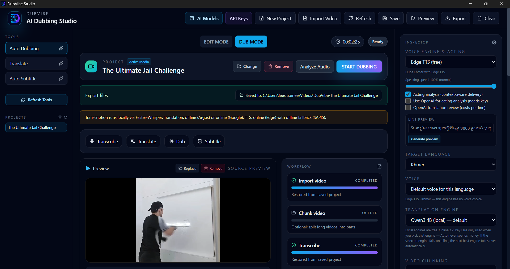

# DubVibe Studio

DubVibe is a local-first AI video dubbing studio for Windows. It combines a dark timeline video editor UI, a FastAPI backend for orchestration, and a modular AI provider layer for transcription, translation, and speech synthesis — built around smart chunk processing so long movies dub fast, reliably, and with the original sound intact.


## Architecture

- Frontend: React + TypeScript + Vite + Tailwind CSS (Zustand state)
- Backend: FastAPI with WebSocket live progress and SQLite project storage
- Media engine: FFmpeg/FFprobe (staged audio mixing, per-part renders, sidechain ducking)
- Desktop shell: Tauri (NSIS installer, bundled Python backend sidecar + FFmpeg)
- AI layer: interchangeable providers with automatic fallback —
  Faster-Whisper (local) → Qwen3 4B (local translation) → Argos Translate (offline) → Google Translate (online, retried) → Gemini / OpenAI / CodeCraft (online translation, keyed; CodeCraft has a free monthly tier) → Gemini TTS / OpenAI TTS (online, keyed) → Edge TTS (online, retried) → VoxCPM2 (offline, English, optional) → Khmer MMS-VITS (offline, Khmer only) → SAPI5 (offline).
  API keys live in Windows Credential Manager (never in the browser); AI acting analysis reads the scene and steers supported TTS engines; paid TTS results are cached.

## Quick start (development)

Requirements: Node.js, Python 3.10, and FFmpeg/FFprobe on `PATH`. Translation and Edge TTS need internet; Faster-Whisper downloads its model on first transcription.

1. Install dependencies:
   `npm install` and `npm --prefix frontend install`
2. Create DubVibe's isolated Python environment:
   `npm run setup:backend`
3. Run the dev stack:
   `npm run dev`
4. Open the studio at http://localhost:5173 (API docs at http://localhost:8001/docs).

## Building the Windows app

```bat
cd C:\dub-vibe
npm run build:sidecar
npm run tauri:build
```

`build:sidecar` packages the whole Python backend plus FFmpeg into a single exe; `tauri:build` compiles the frontend and shell and produces the installer at `src-tauri\target\release\bundle\nsis\DubVibe Studio_0.1.0_x64-setup.exe`. The installed app needs no Python, Node, or separately installed FFmpeg.

## Dubbing workflow

- **Import** uploads the video into the local project and reads its duration/resolution with FFprobe.
- **Chunk** (optional) splits long videos into fixed-length parts (1–15 minutes) with a fast FFmpeg stream copy. Pick the part length in the Inspector, or just press START DUBBING and it splits automatically. Part chips show which parts are already dubbed, and part markers appear on the timeline. Transcription runs part by part while every timestamp stays on the original timeline.
- **Transcribe** runs Faster-Whisper locally (`base` model by default) and stores speech segments with timestamps.
- **Translate** uses offline Argos Translate when the language pair is available, otherwise the Google Translate endpoint — each segment retried with backoff. Finished translations are saved as they complete, so a failed run resumes where it stopped instead of starting over. Online engines verify every line actually came back in the target script (e.g. Khmer) at subtitle length — **one API call per line, as usual**. A reasoning/analysis dump, a `<think>` block, or a doubled line is cleaned and the real sentence salvaged locally at no extra cost; an unrecoverable answer fails over to the next engine, so a Khmer project is never dubbed from English text or an analysis essay.
- **Dub** synthesizes each translated segment with Edge TTS (offline SAPI5 fallback), also resumable, with progress reported per segment and per part.
- **Audio separation** (optional, CapCut-style): splits the original audio into dialogue, music, and SFX/ambience stems (Demucs, runs locally). After separation, exports replace the original voices with the dub while the effects and music bed stays intact — and the auto-duck dips the bed under dub lines. Bundled into the desktop build.
- **Export** renders the final deliverables:
  - *One combined video*, *separate parts* (Part 1…N, each a standalone dubbed MP4), or both.
  - Files are written **directly into a selected folder** — default `Videos\DubVibe\<project name>` — no zip, no browser downloads. A folder picker button makes choosing effortless.
  - **Auto-duck (movie feel):** the original audio plays at full volume everywhere except while a dubbed line is speaking, where it dips to the slider level and fades back — action scenes keep their punch, dialogue stays clear. Turn it off for the classic constant-level mix.
  - Optional WebVTT subtitles, optionally burned into the MP4.

While a workflow runs, progress streams live over WebSocket into the workflow panel and the processing log (timestamps, per-part/per-segment messages, errors). The preview player plays the dubbed segments in sync with the video, and once exported, the dubbed MP4 plays in the Dubbed preview card.

## Projects

Projects (media, transcripts, translations, dub audio, chunk and export state) persist in a local SQLite database and restore when the app reopens. The sidebar lists every project — click to switch, trash to delete (media and exports included). Each export's destination folder is remembered.

## VoxCPM Voice Clone (DUB mode)

Choose **VoxCPM2 Voice Clone (English, own voice)** in the DUB mode voice engine list to dub a project in each speaker's own voice. For each speaker, the app cuts a short reference clip from that speaker's longest clean line in the source video, then speaks every translated line with VoxCPM2 in clone mode. The output uses the normal dub timeline, so overlap fitting and export work as they do for other engines.

- Works only for English targets. Other languages are refused with a clear message instead of producing garbled audio.
- A line that fails stops the run rather than falling back to another voice, so the cloned voice never silently changes. Re-running resumes from the finished lines.
- Requires the VoxCPM2 model (download it in AI Models) and FFmpeg.
- Generation is verified for English. Speed on CPU is roughly 40–80 seconds per short line; an NVIDIA GPU with a CUDA build of torch is much faster.

**GPU Acceleration Pack (NVIDIA CUDA 12):** the pack speeds up Faster-Whisper transcription only. VoxCPM uses the GPU when a CUDA build of torch is installed. MMS, NLLB, and Demucs run on CPU.

## AI Model Manager

All downloaded AI models live in one shared store — `%LOCALAPPDATA%\DubVibe Studio\models` — used identically by the local web UI and the packaged Windows app. The backend is the single source of truth: it discovers, downloads (with live progress), validates, loads, unloads, and deletes models; the browser never touches the filesystem.

Open **AI Models** in the header to manage Faster-Whisper transcription models — Tiny, Base, Small, **Medium**, Large-v3, and Large-v3-Turbo. Each model shows its status (Not installed / Downloading / Installed / Loaded / Error) with controls matching the state, and a radio selects the model used for transcription. The panel also shows detected hardware (CPU/RAM/GPU with CUDA), disk usage, and transcription settings (language, beam size). Selected model, device, and compute persist in the app settings and are used by both interfaces. Transcriptions can be cancelled mid-run, keeping the segments found so far. After the first download, transcription runs fully offline.

**Voice Gender Classifier (optional, ~60 MB):** the `JaesungHuh/voice-gender-classifier` model (ECAPA-TDNN, MIT, ~60 MB) powers male/female detection during Detect Speakers, so Mixed voice and Character voices pick the correct dub voice from what each speaker actually sounds like (the median-pitch F0 heuristic stays as the fallback). It downloads automatically on the first Detect Speakers run and is also installable/deletable from the AI Models panel.

**VoxCPM2 offline voice (optional, English):** the `openbmb/VoxCPM2` model (2B parameters, Apache-2.0, about 4.7 GB) is stored under `models\voxcpm\VoxCPM2`. It is chosen explicitly in the TTS provider list and runs fully offline. Only English has been verified to produce intelligible speech here; Khmer and Thai came out garbled in testing, so VoxCPM2 is not offered for those languages. It runs on CPU but is slow (about 40 s per short line on a CPU-only machine); an NVIDIA GPU is recommended. Install its runtime with `npm run setup:backend`, which installs `voxcpm` without upgrading the pinned stack.

**Khmer offline voice (optional):** the fine-tuned `khmerttsopensource/khmer-tts` model (MMS-VITS, about 320 MB) is stored under `models\mms-tts\mms-tts-khm`. It is used only for Khmer, only after Edge TTS fails, and runs fully offline. Its license is **cc-by-nc-4.0 (non-commercial)**, so do not use it in commercial deployments.

## Settings

| Variable | Purpose |
| --- | --- |
| `DUBVIBE_MODELS_DIR` | Where Whisper/Argos models are stored (default `<AppRoot>\models`, falling back to `%LOCALAPPDATA%\DubVibe\models`) |
| `DUBVIBE_WHISPER_MODEL` | Whisper model size (`base` default) |
| `DUBVIBE_ALLOWED_ORIGINS` | Extra browser origins allowed to call the local API |
| `DUBVIBE_CA_BUNDLE` | Extra PEM file of trusted root CAs, added on top of the Windows store (for corporate TLS inspection) |

### Corporate networks and SSL inspection

If an online provider fails with `<urlopen error [SSL: CERTIFICATE_VERIFY_FAILED] certificate verify failed: unable to get local issuer certificate>`,
a firewall (FortiGate, Zscaler, Palo Alto...) is re-signing HTTPS traffic with a private CA that Windows does not trust. Certificate
verification is never disabled. Fix it by one of:

1. Have IT install the inspection root CA in the Windows **Trusted Root Certification Authorities** store (machine or user).
2. Have IT exempt `codecraftapi.com` (or the affected host) from SSL inspection.
3. Point `DUBVIBE_CA_BUNDLE` at that CA exported as a PEM file and restart the app.

## Project goals

- Local-first media processing — nothing leaves the machine except translation/TTS calls
- Timeline-centric AI dubbing workflow
- Smart chunk processing for long videos ✅
- Resilient pipelines: retries, resume, and never-lose-work persistence ✅
- Movie-style audio: per-part exports, folder delivery, auto-ducking ✅
- Windows packaging via Tauri shell ✅

## Important note

DubVibe is designed as an extensible foundation for a professional desktop editor. The core architecture, UI shell, backend orchestration, and provider abstractions are in place; natural next steps include speaker diarization with per-actor voices, audio source separation for full movie-mode dubbing, and lip-sync alignment.
